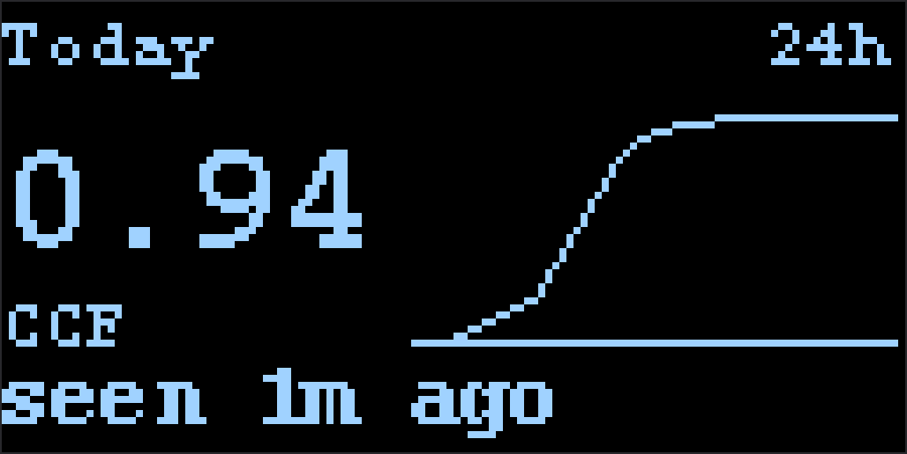
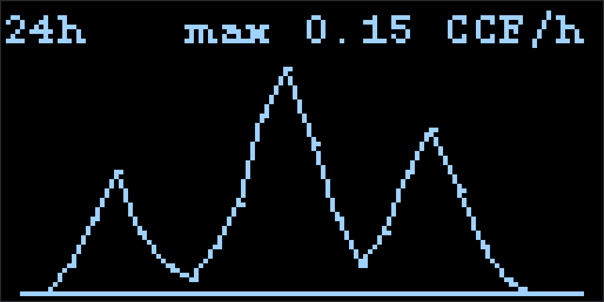

# LilyGO Gas ERT

[](https://github.com/shomanjk/LilyGO-Gas-ERT/actions/workflows/ci.yml)

ESPHome firmware for a **LilyGO LoRa32 915 MHz (SX1276)** that receives **Itron ERT-SCM** utility-meter broadcasts (ASK/OOK — **not LoRa**) and reports consumption to **Home Assistant** (native API) or any **MQTT** broker.

Use it to read **your own** meter. Receiving utility AMI broadcasts may be regulated where you live. This project is not affiliated with Itron or any utility.

### Where it was tested

Developed and run against **Itron ERT-SCM** gas meters in the **Austin, Texas** area (Texas Gas Service). Other North American utilities that still broadcast classic **ERT-SCM** on **915 MHz** ASK/OOK are likely to work the same way; SCM+ / IDM are not implemented yet.

**Hardware that works here:** [LilyGO](https://www.lilygo.cc/) **T3 / LoRa32 V2.1_1.6.1**, **915 MHz** module with **Semtech SX1276** (often sold as “LoRa32 915 MHz” — we use **OOK continuous RX**, not LoRa). Same class of board is widely available under TTGO / LilyGO LoRa32 labels; confirm **DIO2 → GPIO32** on your revision.

Search keywords: Austin TX gas meter, Texas Gas Service ERT, Itron SCM ESPHome, LilyGO LoRa32 915 SX1276 OOK, Home Assistant gas ERT.

### Onboard OLED

Optional SSD1306 pages on the LilyGO (enable the display block in the device YAML). Mocks of the two rotating views:

<p>
  
  
</p>

| Today | 24h graph |
|-------|-----------|
| Today’s total (CCF), last-heard age, cumulative 24 h sparkline | Hourly usage sparkline with peak CCF/h |

<!-- Photos: add files under docs/images/ (see docs/images/README.md), then uncomment:


-->

## Status

| Piece | State |
|-------|--------|
| SX1276 OOK + `remote_receiver` | Working on T3 / LoRa32 V2.1_1.6.1 915 MHz |
| `ert_scm` decode + allowlist + scale | Working |
| Home Assistant via native API | Supported (default example) |
| MQTT retained topics | Supported |
| Onboard OLED / usage history | Optional ([mocks above](#onboard-oled); see device YAML) |

## Two integration modes

| Mode | Who it’s for | Example |
|------|----------------|---------|
| **Home Assistant API** (default) | HA users; no MQTT broker needed | [`examples/ha-api.yaml`](examples/ha-api.yaml) |
| **MQTT only** | Non-HA dashboards, Node-RED, custom consumers | [`examples/mqtt-only.yaml`](examples/mqtt-only.yaml) |

You can enable both, but that is unusual: you will get duplicate readings unless local sensors are `internal: true` while MQTT is the source of truth.

```text
SX1276 OOK continuous RX (ESPHome sx127x)
  → DIO2 demodulated bitstream → remote_receiver
  → ert_scm (SCM decode + allowlist + scale)
       ├─ HA native API sensors   (ha-api example)
       └─ MQTT meters/gas/{id}/…  (mqtt-only example)
```

Radio path (required):

- [ESPHome SX127x](https://esphome.io/components/sx127x/) — **FSK/OOK Continuous Mode → As a Receiver** (`modulation: OOK`, `packet_mode: false`)
- [ESPHome remote_receiver](https://esphome.io/components/remote_receiver/) on **DIO2** (demodulated bitstream)

This is **not** LoRa mode. Do not configure the SX1276 as a LoRa modem for ERT-SCM.

## Hardware (tested board)

Tested on **LilyGO T3 / LoRa32 V2.1_1.6.1 915 MHz**. Confirm your silkscreen / variant before chasing “no pulses” — older TTGO revisions sometimes need DIO1/DIO2 jumpers.

Photos go in [`docs/images/`](docs/images/) (board, HA dashboard). OLED page mocks are already linked [above](#onboard-oled).

| Function | GPIO |
|----------|------|
| SCK | 5 |
| MISO | 19 |
| MOSI | 27 |
| CS | 18 |
| RST | 23 |
| DIO0 | 26 |
| DIO1 | 33 |
| **DIO2 (OOK data)** | **32** |
| OLED SDA / SCL | 21 / 22 |
| LED | 25 |

USB-serial on this board (CH9102) flashes most reliably at **115200** baud.

## Quick start (HA API)

1. **Hardware:** board above; **DIO2 must be GPIO32**.
2. **Secrets:** copy key names from [`secrets.example.yaml`](secrets.example.yaml) into the ESPHome add-on’s `secrets.yaml` (Wi‑Fi + `api_encryption_key` for the HA example). Never commit real `secrets.yaml`.
3. **Config:** create a device in the HA ESPHome add-on and paste [`examples/ha-api.yaml`](examples/ha-api.yaml). Set `house_meter_id` and, if needed, `ert_frequency`. Keep examples generic — placeholders only (`YOUR_METER_ID`, example frequencies); no real meter IDs or LAN hosts in shared YAML.
4. **Component:** the YAML pulls `ert_scm` via `external_components` `type: git` with `ref: v1.1.2` (see [CHANGELOG](CHANGELOG.md)). The HA add-on cannot see a local checkout path; use `type: local` only when developing the component outside HA.
5. **Install**, adopt the device in HA, and confirm the consumption entity updates (ERT hops are sparse — often several minutes between hits).

MQTT-only users: start from [`examples/mqtt-only.yaml`](examples/mqtt-only.yaml) instead and subscribe to the topics below.

<details>
<summary>Building outside Home Assistant (validation)</summary>

```bash
cp secrets.example.yaml esphome/secrets.yaml   # gitignored
docker run --rm -v "$PWD":/config ghcr.io/esphome/esphome:2026.9.1 \
  config /config/examples/ha-api.yaml
```

For local `ert_scm` changes, temporarily use `type: local` / `path: ../components`.
</details>

## Find your meter and frequency

- **Meter ID:** on the ERT sticker, or leave the allowlist empty temporarily — `ert_scm` logs every decoded frame (`SCM id=…`).
- **Channels:** with an RTL-SDR, `rtl_433 -f 915M -s 1024k -M level` and note `freq` for your id. One site saw a fixed ~12.5 min hop cycle near **914.65** and **914.83** MHz; treat that as an example, not a universal default. Start around your strongest channel, `bandwidth: 250_0kHz`, and tune `rx_floor`.

## Units (`scale`)

On the meter this project was developed against, raw ERT `consumption_data` counts **cubic feet**. With default `scale: 100`, the reported value is **CCF** (hundreds of cubic feet). **Verify on your meter** before trusting Energy dashboards:

- compare `raw` (or the API sensor × scale) with the dial, or  
- compare a bill’s CCF with the change in raw over the same period.

If you use `scale: 1`, treat the value as ft³ and set HA’s `unit_of_measurement` accordingly. Always treat `scale` as site-specific.

## MQTT topic contract (MQTT mode)

Retained, QoS 0, only for **enabled** allowlisted IDs. Keep this shape if you want drop-in compatibility with existing dashboards:

| Topic | Payload |
|-------|---------|
| `meters/gas/{id}/consumption` | raw ÷ `scale`, 2 decimals (CCF with default scale 100) |
| `meters/gas/{id}/raw` | Integer `consumption_data` |
| `meters/gas/{id}/rssi` | Frame peak in **dBm** (1 decimal), when available |
| `meters/gas/{id}/last_seen` | Local `YYYY-MM-DDTHH:MM:SS` after SNTP sync |

Override the prefix with `mqtt_topic_prefix` if you need a temporary shadow topic while migrating from another collector.

## Troubleshooting

Watch the minute `stats:` log line from `ert_scm`:

| Symptom | Likely cause |
|---------|----------------|
| No pulses / no captures | Wrong board variant or DIO2 not on GPIO32 |
| `preambles` rising, `frames` = 0 | Timing / polarity; leave dual-polarity decode on |
| `crc_err` rising | Weak signal; adjust `rx_floor`, placement, frequency |
| `publish_skipped` rising | MQTT disconnected (MQTT mode) |
| No `last_seen` | SNTP not synced yet |
| Hits only every ~12 min | Normal for many ERTs (hop cycle), not a one-per-minute beacon |

## Layout

```text
examples/ha-api.yaml         # HA native API (default)
examples/mqtt-only.yaml      # MQTT only
esphome/lilygo-gas-ert.yaml  # Radio scaffold / bring-up notes
components/ert_scm/          # External component
tests/                       # Host unit tests (make -C tests)
secrets.example.yaml         # Secret key names only
docs/PLAN.md                 # Design / RF notes
docs/images/                 # Board / OLED / HA screenshots
```

## Not in scope

Weather / La Crosse, ADS-B, running Mosquitto on the device, LoRa mesh, or a second radio stack (PlatformIO / `rtl_433_ESP`) as a maintained path in this repo.

## References

Protocol details (frame layout, preamble, CRC-16 poly 0x6F63) are from the public descriptions in rtl_433 (`src/devices/ert_scm.c`) and the rtlamr documentation. No code from either project is used (those projects are GPL / AGPL).

## License

[Apache License 2.0](LICENSE).
